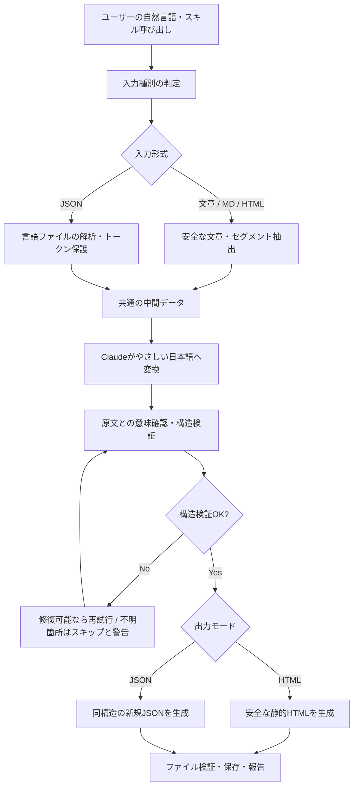

# 03. 技術設計（MVP）

## 設計方針

- **変換判断はLLM**：やさしい日本語への言い換え、意味の照合、要確認箇所の抽出。
- **機械的保証はコード**：文字列抽出、JSON構造保持、プレースホルダー検証、HTMLエスケープ、ファイル保存。
- **人が最終確認**：特に行政・法務・医療・防災等の情報。
- **非破壊**：入力ファイルも既存の成果物も無断上書きしない。
- **最小依存**：Claude Code + Node.js/TypeScript（推奨）。専用サーバーやGoogle等の別APIは使わない。

## 処理フロー



※「意味確認」はLLMによる判断を含み、形式検証と同じ意味での自動保証ではない。

## データ契約：文章セグメント

抽出した文章は、変換前に安定したIDを持つ中間表現にする。例：

```json
{
  "source": {"kind": "markdown", "path": "docs/notice.md"},
  "segments": [
    {"id": "s1", "kind": "heading", "original": "参加者へのご案内", "easy": null},
    {"id": "s2", "kind": "paragraph", "original": "申請を希望される方は、必要事項をご記入ください。", "easy": null}
  ],
  "warnings": []
}
```

- `id` はファイル内で一意。LLMへは必要なテキストとIDを渡し、IDが返らなければ再試行／失敗とする。
- `kind` は heading / paragraph / list-item / quote / caption 等の必要最小限。
- `original` は変換前の正確な文字列。`easy` にLLMの変換結果を格納。
- `warnings` はカテゴリ、セグメントID、説明、検証状態を持つ。根拠のない「合格」表示は禁止。
- 長い段落を複数文に分けても、セグメントのIDは維持。画面上の段落構造は出力生成で安全に整える。
- プレーンテキストは改行や空行を使ってセグメント化。日本語本文の完全な原文は別途保持可能にする。

## HTMLプレビューモード

### テキスト・Markdown入力

- 文字列の直接入力は段落に分割。
- Markdownは Markdown パーサー（候補：unified / remark）でASTとして読み、見出し・段落・箇条書きの本文を抽出。
- フェンス付きコード、インラインコード、リンクURL、画像URL、フロントマター、HTML埋め込みの実行可能部分は変換しない。
- Markdownの構造はプレビューに反映するが、元のデザインを完全には再現しない。

### HTML入力

- DOMパーサー（候補：parse5 / htmlparser2）で解析。**正規表現だけでHTMLを抽出しない**。
- `h1`〜`h6`、`p`、`li`、`blockquote`、`dt/dd` 等の人が読む本文を抽出する。
- `script`、`style`、`template`、`noscript`、`svg`、`iframe`、`code`、`pre` や属性値、コメントは原則除外。イベントハンドラも出力しない。
- 親要素と子要素の二重抽出を避け、セグメントの出現順を守る。テキストしかない `div` などは必要に応じてフォールバックする。
- HTML中のリンクは、必要なら表示テキストだけを変換し、URLは原文から保持。プレビューのリンクは最初の版で無効化してもよい（誤リンク・危険なURLを避ける）。
- **元HTMLは実行しない**。スタイルやScriptを単体プレビューにコピーしない。

### 生成HTML

- `<!doctype html>`、`<html lang="ja">`、UTF-8メタタグ、レスポンシブ対応。
- すべてのCSS/JSをファイル内に同梱し、オフラインでも動作する。外部CDNやトラッキングなし。
- 通常日本語／やさしい日本語の切替はセマンティックな `<button>` で実装し、キーボード・スクリーンリーダーへの配慮（押下状態・フォーカス等）を行う。
- 原文と訳文はHTMLエスケープして注入。ユーザー由来のHTMLやスクリプトを `innerHTML` に入れない。`textContent` 等の安全な方法を選ぶ。
- 注意事項のあるセグメントは「要確認」として別途一覧表示し、実際に何が疑わしいかを明示。
- デザインは簡潔で読みやすい配色・余白・本文サイズ・コントラスト。インタラクションは切り替えだけ。

## i18n JSONモード

### 入力例

```json
{
  "event": {
    "title": "参加者へのご案内",
    "hello": "{{name}}さん、お申し込みありがとうございます。",
    "deadline": "11月30日までにお申し込みください。",
    "maxCount": 30,
    "labels": ["申請する", "取り消す"]
  }
}
```

### 出力例（イメージ）

```json
{
  "event": {
    "title": "さんかする人へ",
    "hello": "{{name}}さん、もうしこんでくれて ありがとうございます。",
    "deadline": "11月30日までに もうしこんでください。",
    "maxCount": 30,
    "labels": ["もうしこむ", "とりけす"]
  }
}
```

### 不変条件

1. 入力 JSON と出力 JSON の**キーの集合と階層、配列数、配列順、値の型**が一致。
2. 翻訳する文字列内の**保護対象トークン**が完全一致（名称・出現回数・必要に応じ順序も検証）。例：`{{name}}`、`{name}`、`%s` 等。
3. `true` / `false` / `null` / number は変換しない。
4. `ICU plural/select`、リッチテキストタグ、複雑な入れ子など、意味を壊さず解析できない文字列は**そのキーの値を原文のまま維持**して警告。
5. JSONの整形や空白は変わってよいが、データの構造と情報は維持。JSON構文の厳密な解析／再パースを行う。
6. 旧値との比較ができるよう、検証レポート上でキーのパスを表示する（例：`event.hello`）。

**注意**：単純な正規表現のみでICU構文を扱わない。対応範囲を明記し、対応外は安全に保持する。

### i18n識別について

- `ja-easy.json` はデフォルトの出力ファイル名で、フレームワークへの自動導入は行わない。
- `ja-easy` はプロジェクトで独自に定義する表示バリエーション識別子であり、標準言語タグと断定しない。HTML `lang` 属性は日本語の `ja` を使う。

## Claude Code Skillの配置案

最初はClaude Code上での確実な呼び出しを優先して、次を推奨する。

```text
yasashii-ja/
├── README.md
├── CLAUDE.md
├── docs/
├── .claude/
│   └── skills/
│       └── yasashii-ja/
│           ├── SKILL.md
│           ├── references/
│           │   └── rewrite-policy.md
│           └── scripts/        # 必要ならエントリーや共通処理を配置
├── src/                      # 解析・検証・出力のコアコード
│   ├── parse/
│   ├── validate/
│   └── render/
├── tests/
│   └── fixtures/
├── examples/
└── package.json
```

- この構成は**設計案**。スキル内の `scripts/` に実装を寄せるか、共通コアを `src/` に置くかは試作時に決める。
- Claude Codeのプロジェクト用スキルは `.claude/skills/<name>/SKILL.md` からロードされる。配布方法（例：Agent Skills形式、コピー導入、skills CLIへの対応）は実装時に検証する。
- `SKILL.md` は短く、起動条件・入力処理・安全上の約束・処理手順を書き、詳細な文体ルールは `references/` に分離。
- 最低限のfrontmatterは `name: yasashii-ja` / `description: ...` を定義。自動呼び出しの効果をテストする。
- Claude Codeの引数は `$ARGUMENTS` を利用可能。ファイル指定・直接テキストは内容を検証して区別する。

## 想定される技術スタック

- Node.js + TypeScript（推奨案。ユーザー向けのCLIライブラリより、MVPで確実に動く小さな仕組みを優先）
- MD解析：remark / unified など
- HTML解析：parse5 / htmlparser2 など
- JSON：標準パーサ＋独自の構造・プレースホルダー検証
- テスト：Node.js test runner または Vitest
- HTMLテンプレート：フレームワーク不要の静的テンプレート

**依存ライブラリとバージョンは、実装時に必要性・ライセンス・メンテナンス状況を確認して決める。**

## セキュリティ・データ取扱い

- ユーザー文書は命令文として実行しない。テキスト抽出と変換の対象として扱う。
- 出力に注入される文字列・属性をエスケープ／検査し、XSSを防ぐ。
- JSONの `__proto__` 等のキーによるプロトタイプ汚染に注意。AST/JSON処理で安全な走査を行う。
- 入出力パスを明示して、無制限の再帰探索・隠しファイルスキャンをしない。
- 過剰なデータをLLMに送らない。機密情報を含む場合はユーザーに注意を示す。モデルの利用条件に従う。
- 失敗時は入力を保持し、既存出力を壊さない。テンポラリ出力の完成後に安全な保存を行う。
